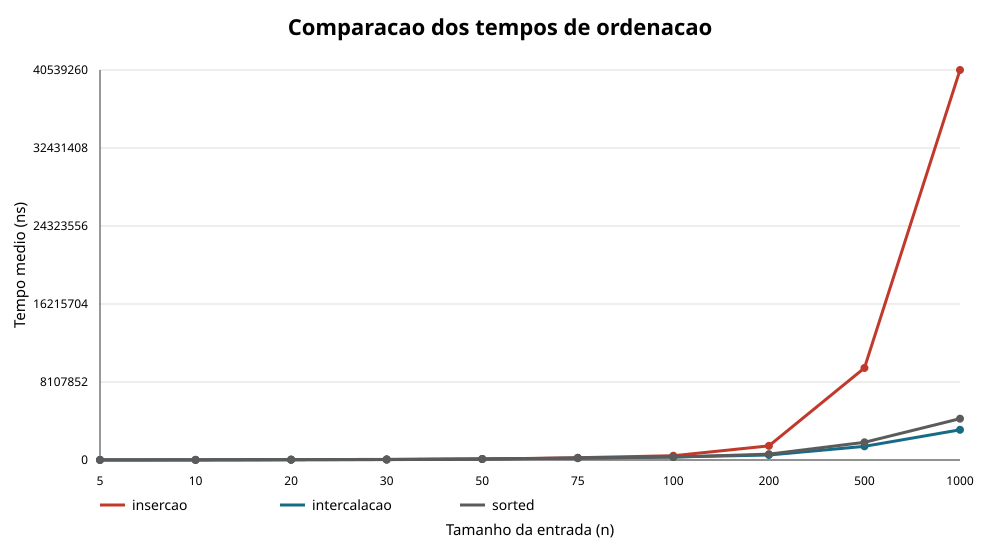
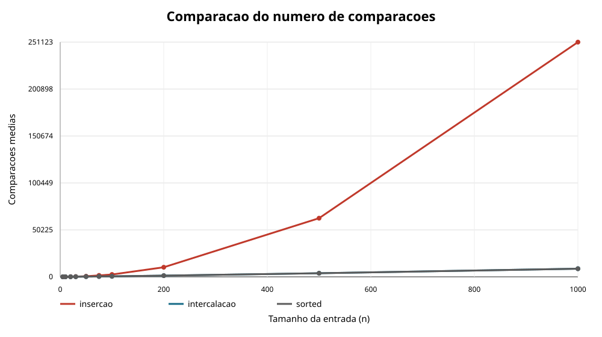

# 📊 Comparação de Algoritmos de Ordenação

**Análise experimental de desempenho: Insertion Sort × Merge Sort × `sorted()`**

Projeto acadêmico desenvolvido para investigar o comportamento de diferentes métodos de ordenação, comparando seu tempo de execução e a quantidade de comparações realizadas em listas de tamanhos variados.

O experimento combina implementação, testes automatizados, coleta de dados e visualização gráfica para demonstrar como o tamanho da entrada influencia o desempenho de cada abordagem.

---

## 🎯 Objetivos

- Implementar os algoritmos de **ordenação por inserção** (*Insertion Sort*) e **ordenação por intercalação** (*Merge Sort*).
- Medir o tempo de execução de cada algoritmo em listas aleatórias.
- Contabilizar as comparações entre elementos durante a ordenação.
- Comparar os resultados com o método nativo `sorted()` do Python.
- Gerar tabelas e gráficos para analisar os resultados obtidos.
- Investigar a relação entre eficiência prática e complexidade algorítmica.

## 🧠 Algoritmos analisados

| Algoritmo | Estratégia | Complexidade de tempo típica |
|---|---|---|
| Insertion Sort | Insere cada elemento na posição correta em uma parte já ordenada da lista. | \(O(n^2)\) no caso médio e pior |
| Merge Sort | Divide a lista em partes menores, ordena cada parte e intercala os resultados. | \(O(n\log n)\) |
| `sorted()` | Utiliza o algoritmo Timsort, implementado na biblioteca padrão do Python. | \(O(n\log n)\) no pior caso |

As complexidades teóricas ajudam a formular expectativas, mas não substituem a medição prática. Custos de memória, chamadas de funções, recursão e características da implementação também influenciam o tempo observado.

## 🔬 Metodologia experimental

O programa executa os algoritmos sobre listas aleatórias com os seguintes tamanhos:

`5 · 10 · 20 · 30 · 50 · 75 · 100 · 200 · 500 · 1000`

Para cada tamanho, são realizadas **10 repetições**. Os dados são gerados com uma semente aleatória fixa, permitindo reproduzir a mesma sequência de entradas.

São coletadas duas métricas principais:

- **Tempo de execução:** medido em nanossegundos com `time.perf_counter_ns()`.
- **Número de comparações:** contabilizado durante a execução dos algoritmos. No caso de `sorted()`, é utilizado um objeto que registra as chamadas ao método `__lt__`.

Os resultados são consolidados em médias, registrados em um arquivo CSV e apresentados em dois gráficos.

## 📈 Resultados e visualizações

Os experimentos geram dois gráficos:

**1. Tempo médio de execução**



**2. Número médio de comparações**



As tabelas, os gráficos e a interpretação dos resultados estão disponíveis no [relatório experimental](RELATORIO.md).

> Os tempos medidos podem variar entre computadores e execuções. As comparações entre elementos são uma métrica diferente do tempo total e não representam, isoladamente, todos os custos do algoritmo.

## 📁 Estrutura do projeto

```text
comparacao-de-algoritmos/
├── ordenacao.py
├── testes.py
├── medir.py
├── README.md
├── RELATORIO.md
└── dados/
    ├── dados.csv
    ├── grafico_tempos.svg
    └── grafico_comparacoes.svg
```

| Arquivo | Responsabilidade |
|---|---|
| `ordenacao.py` | Implementa os algoritmos e suas versões com contagem de comparações. |
| `testes.py` | Contém testes automatizados para diferentes condições de entrada. |
| `medir.py` | Executa os experimentos, calcula médias e gera os arquivos de resultados. |
| `dados/` | Armazena os dados coletados e os gráficos produzidos. |
| `RELATORIO.md` | Apresenta os resultados e discute as conclusões do experimento. |

## ⚙️ Como executar

### Requisitos

- Python 3.8 ou superior.
- Nenhuma biblioteca externa é necessária para executar os scripts atuais.

### 1. Executar os testes

Na pasta do projeto, execute:

```bash
python -m unittest testes.py
```

Os testes verificam casos como lista vazia, elemento único, elementos iguais, lista já ordenada, lista em ordem inversa e lista aleatória.

### 2. Executar o experimento

Execute o comando abaixo para realizar as medições:

```bash
python medir.py
```

O script executa os experimentos, calcula as médias, salva os resultados individuais em `dados/dados.csv` e gera os gráficos de tempo médio e de comparações médias.

O arquivo `RELATORIO.md` é mantido separado do processo de medição e deve ser atualizado manualmente quando os resultados do experimento forem alterados.

## 💡 Principais questões investigadas

- A partir de qual tamanho de entrada o Merge Sort apresenta menor tempo de execução?
- A quantidade de comparações acompanha o comportamento do tempo medido?
- Como o desempenho de `sorted()` se compara ao dos algoritmos implementados?
- Por que um algoritmo com menor complexidade assintótica pode não ser o mais rápido em entradas pequenas?
- Em quais situações a ordenação por inserção continua sendo uma alternativa interessante?

As respostas são desenvolvidas no relatório, com base nos resultados obtidos e nas características de cada algoritmo.

---

**Projeto acadêmico — Estrutura de Dados Avançadas**  
Experimento de análise de algoritmos de ordenação em Python.